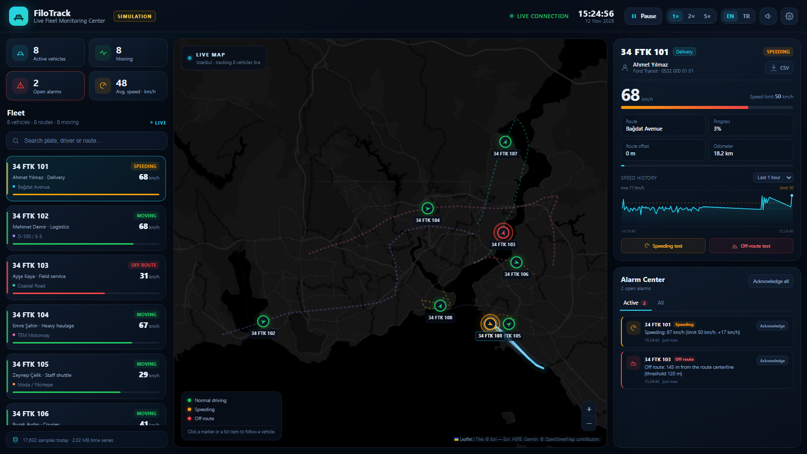
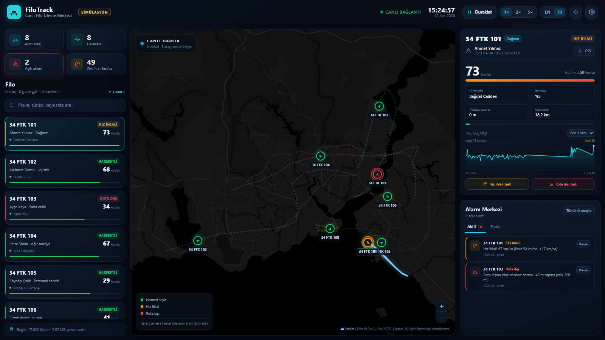

# FiloTrack — Live Fleet Monitoring and Alarm System

A fleet tracking dashboard that shows the live position, speed and route history
of vehicles on a simulated map, stores every position as a **time series** in
SQLite, and raises instant alarms for **speeding** and **leaving the route**.

No third-party Python packages are needed; only the Python standard library is
used. The frontend dependency (Leaflet) is bundled with the project. The base map
needs an internet connection; without it, routes and vehicles still work.

The dashboard is available in **English and Turkish** (switch with `EN | TR` in
the top bar).

**CEN317 – Engineering Design** · midterm project

## Team

| Student ID | Name |
|---|---|
| 2022556036 | Abdullah Karabudak |
| 2022556003 | Fatih Aksoy |
| 2022555475 | Yusuf Can |



---

## Contents

1. [Features](#features)
2. [Quick start](#quick-start)
3. [Docker](#docker)
4. [CI/CD](#cicd)
5. [Architecture](#architecture)
6. [Time-series data model](#time-series-data-model)
7. [Alarm rules](#alarm-rules)
8. [API](#api)
9. [Simulation](#simulation)
10. [Languages (i18n)](#languages-i18n)
11. [Frontend styles](#frontend-styles)
12. [Project structure](#project-structure)
13. [Screenshots](#screenshots)
14. [Notes and limitations](#notes-and-limitations)

---

## Features

- **Live map dashboard** — 8 vehicles on 8 realistic Istanbul routes (Bağdat Avenue,
  D-100/E-5, TEM, Coastal Road, Historic Peninsula, Moda, Büyükdere Avenue,
  Bosphorus Crossing).
- **Real-time tracking** — position, speed, heading, route progress, distance from
  the route centerline and odometer, updated every second.
- **Route history** — the selected vehicle's trail for the last 15 min / 1 h / 6 h
  is drawn on the map, with a speed history chart.
- **Time-series storage** — every measurement is appended to the `positions` table,
  queried through a `(vehicle_id, ts)` index and cleaned up by a retention policy.
- **Alarm engine** — speeding and off-route rules confirmed over consecutive
  measurements; warning / critical severity, automatic resolution and acknowledgement.
- **Instant notification** — server push over SSE every second; colored map markers,
  alarm center, toast notifications and a WebAudio alarm sound.
- **Live indicators** — open alarms, moving vehicles, average speed, samples today,
  database size.
- **Simulation controls** — pause / resume, 1× / 2× / 5× speed, and "speeding" and
  "off route" test scenarios for the selected vehicle.
- **Adjustable thresholds** — speed tolerance, off-route threshold and data retention
  can be changed from the dashboard and are persisted in SQLite.
- **CSV export** — raw time series of the selected vehicle for the selected range.
- **Bilingual, dark, responsive UI** — English / Turkish; three columns on desktop,
  stacked on narrow screens.

---

## Quick start

### Requirements

- **Python 3.10+** (tested with 3.12 and 3.14)
- A modern web browser
- Internet access for the base map (optional; routes are visible without it)

### Running

**Windows (recommended):** double-click `start.bat` in the project folder.

`start.bat` tries `py -3`, `python` and `python3` in that order, actually runs each
one and checks that it is version 3.10+. This avoids the Windows Store shortcut
`WindowsApps\python.exe`, which is on PATH but only prints "Python was not found".

**Command line:**

```bash
python app.py        # on Windows: py app.py
```

The browser opens `http://127.0.0.1:8000` automatically. If it does not, enter the
address manually.

### Command-line options

```bash
python app.py --port 8080          # different port
python app.py --host 0.0.0.0       # allow access from other devices on the network
python app.py --speed 3            # start the simulation at 3× speed
python app.py --no-open            # do not open the browser
python app.py --reset              # delete the database and start fresh
python app.py --verbose            # HTTP request logs
```

Press `Ctrl+C` in the terminal to stop.

> **Data:** measurements accumulate in `data/filotrack.db` and survive restarts;
> `--reset` deletes them. Databases from earlier versions (`data/filotakip.db`) are
> renamed automatically on first start, so their history is kept.

### Tests

```bash
start.bat test                           # Windows
python -m unittest                       # any platform (auto-discovery, works with VS Code)
python -m unittest discover -s tests -v  # verbose output
python tests/test_storage.py             # a single test file
```

No extra packages (only `unittest`). 137 tests, about 1 second:

| File | Covers |
|---|---|
| `test_geo.py` | Haversine, bearing, distance to polyline, perpendicular offset, route projection |
| `test_clock.py` | Epoch ms, local day start |
| `test_storage.py` | Time-series writes / reads, downsampling, speed series, statistics, alarm lifecycle, settings, retention, legacy database migration |
| `test_alarm_engine.py` | Consecutive-sample confirmation, tolerance boundary, severity, de-duplication, resolution, acknowledgement, settings changes |
| `test_simulation.py` | Acceleration limits, scenarios, route-end turnaround / loop, snapshot, simulator thread |
| `test_api_units.py` | Router (404 / 405, parameters), query parameters, settings validation, CSV format |
| `test_api_http.py` | Every endpoint through a real HTTP server, error codes, static file security, every stylesheet / script referenced by `index.html`, SSE |
| `test_i18n.py` | English and Turkish dictionaries define the same keys and placeholders; every key used by the HTML / JS exists; every backend vehicle kind is translated |
| `test_map_markers.py` | Vehicle markers keep Leaflet's positioning (regression: markers drawn off their route) |

### Linting

```bash
pip install ruff==0.17.4
ruff check .          # rules are configured in pyproject.toml
```

---

## Docker

```bash
docker build -t filotrack .
docker run -p 8000:8000 -v filotrack-data:/data filotrack
```

Open `http://127.0.0.1:8000`. The image runs as an unprivileged user, keeps the
SQLite database in the `/data` volume and has a `HEALTHCHECK` on `/api/health`.
Released images are published to the GitHub Container Registry (see below):

```bash
docker run -p 8000:8000 -v filotrack-data:/data ghcr.io/<owner>/<repo>:latest
```

---

## CI/CD

GitHub Actions workflows live in `.github/workflows/`.

**CI** (`ci.yml`) runs on every push to `main` / `master`, on every pull request and
manually (`workflow_dispatch`):

| Job | What it checks |
|---|---|
| Lint | `ruff check` with the rules from `pyproject.toml`; `node --check` for `web/js/*.js` |
| Tests | the full test suite on **Ubuntu and Windows** × **Python 3.10, 3.12, 3.14** (6 runs) |
| Smoke test | starts `app.py`, checks the dashboard and `/api/state`, triggers a speeding scenario and waits for the alarm |
| Docker image | builds the image, runs it and checks `/api/health` |

**CD** (`release.yml`) runs when a version tag is pushed:

```bash
git tag v1.0.0
git push origin v1.0.0
```

1. The test suite runs again.
2. A **GitHub Release** is created with generated release notes and a source
   archive `filotrack-v1.0.0.zip` (built with `git archive`).
3. A **Docker image** is pushed to `ghcr.io/<owner>/<repo>` with the tags `1.0.0`,
   `1.0` and `latest`.

Both use the built-in `GITHUB_TOKEN`; no secrets need to be configured. If the
repository (or organization) restricts workflow permissions, allow
*Read and write permissions* under **Settings → Actions → General**. Dependabot
(`.github/dependabot.yml`) opens weekly pull requests for newer action and base
image versions.

---

## Architecture

```
┌──────────────────────────────── Browser ─────────────────────────────┐
│  index.html · css/** · js/i18n.js · js/app.js                        │
│  Leaflet map · vehicle markers · route / history lines               │
│  KPI cards · vehicle list · alarm center · speed chart · EN | TR     │
└───────────┬───────────────────────────────────▲──────────────────────┘
            │ REST (JSON)                       │ SSE  /api/stream
            ▼                                   │ (1 snapshot per second)
┌─────────────────────── Python (stdlib) ───────┴──────────────────────┐
│  api/         HTTP server → router → endpoints · SSE · static files  │
│                    │                                                 │
│  simulation/  simulator thread (1 Hz) → vehicle model → snapshot     │
│                    │                                                 │
│  alarms.py    rule engine (speeding / off route)                     │
│                    │                                                 │
│  storage/     Database → vehicles · positions · alarms · settings    │
└───────────────────────────┬──────────────────────────────────────────┘
                            │ SQLite (WAL)
                            ▼
                 data/filotrack.db
                 ├── vehicles
                 ├── positions   ← append-only time series
                 ├── alarms
                 └── settings
```

- The simulator produces measurements at **1 Hz** (the speed multiplier only
  changes the distance travelled per tick).
- Each tick writes the measurements to `positions` in one transaction, then the
  alarm engine runs and the dashboard snapshot is broadcast over SSE.
- "Daily" statistics (samples today, alarms today) count from local midnight
  (`clock.local_day_start_ms`).
- Dependencies point one way: `api → simulation → alarms → storage → clock`.
  Lower layers do not know about higher ones; there are no circular imports.
- Endpoints are independent of HTTP: they receive a `Request` and return a
  `Response` or raise `ApiError`. Only `api/server.py` touches the socket.
- The server sends **language-neutral data** (alarm fields, vehicle kind keys);
  the browser renders it in the selected language.
- When the SSE connection drops the browser reconnects automatically; the
  dashboard keeps the last data and shows "Disconnected".

---

## Time-series data model

The `positions` table is an append-only time series:

```sql
CREATE TABLE positions (
    id          INTEGER PRIMARY KEY AUTOINCREMENT,
    vehicle_id  TEXT    NOT NULL,
    ts          INTEGER NOT NULL,   -- epoch milliseconds
    lat         REAL    NOT NULL,
    lng         REAL    NOT NULL,
    speed       REAL    NOT NULL,   -- km/h
    heading     REAL    NOT NULL,   -- degrees, 0 = north
    route_id    TEXT    NOT NULL,
    progress    REAL    NOT NULL,   -- 0..1 along the route
    offset_m    REAL    NOT NULL,   -- distance from the route centerline (m)
    ignition    INTEGER NOT NULL,
    odometer_m  REAL    NOT NULL
);
CREATE INDEX idx_positions_vehicle_ts ON positions (vehicle_id, ts);
CREATE INDEX idx_positions_ts ON positions (ts);
```

Time-series approach:

| Concern | Implementation |
|---|---|
| Writes | One row per vehicle per second; batched `executemany` in a single transaction |
| Queries | Composite `(vehicle_id, ts)` index; time-range filters |
| Downsampling | Map history averaged per time bucket (`AVG`, at most ~1200 points) |
| Charts | `/series` endpoint; bucket size 5–300 s |
| Retention | 24 hours by default; `DELETE ... WHERE ts < cutoff` every 60 s |
| Durability | WAL mode, `synchronous=NORMAL`, single writer thread |
| Export | Raw rows as CSV (UTF-8 with BOM, opens correctly in Excel) |

With the defaults the upper bound is 8 vehicles × 86,400 s ≈ **691,200 rows/day**;
24-hour retention and the indexes are sufficient for this scenario. For larger
fleets, `storage/positions.py` is the single place to switch to a dedicated
time-series database such as TimescaleDB or InfluxDB.

### Alarm table

```sql
CREATE TABLE alarms (
    id           INTEGER PRIMARY KEY AUTOINCREMENT,
    vehicle_id   TEXT    NOT NULL,
    type         TEXT    NOT NULL,   -- SPEED | DEVIATION
    severity     TEXT    NOT NULL,   -- warning | critical
    ts           INTEGER NOT NULL,
    resolved_ts  INTEGER,            -- NULL while the alarm is open
    speed        REAL,
    speed_limit  REAL,
    offset_m     REAL,
    threshold_m  REAL,
    message      TEXT    NOT NULL,   -- English summary
    status       TEXT    NOT NULL    -- active | acked | resolved
);
```

---

## Alarm rules

| Alarm | Condition | Confirmation | Severity |
|---|---|---|---|
| `SPEED` | `speed > limit + tolerance` | 3 consecutive samples (3 s) | **critical** from +20 km/h, otherwise **warning** |
| `DEVIATION` | `distance from centerline > threshold` | 2 consecutive samples | **critical** above 1.8 × threshold |

- The default speed tolerance is **5 km/h** and the off-route threshold **120 m**.
- When the condition clears, the alarm is **resolved** automatically (`resolved_ts`).
- An operator can **acknowledge** an alarm (`acked`); while the condition persists
  no new alarm is created, and the alarm is resolved when it ends.
- Only one open alarm is kept per vehicle and alarm type (no repeated alarms).
- Alarms left open when the application stopped are resolved on the next start.
- Thresholds can be changed from the **Settings** (gear) button; they apply to new
  measurements and are stored in SQLite.

Example alarms (stored message / Turkish UI):

- `Speeding: 72 km/h (limit 50 km/h, +22 km/h)` · `Hız ihlali: 72 km/sa (limit 50 km/sa, +22 km/sa)`
- `Off route: 156 m from the route centerline (threshold 120 m)` · `Rota dışına çıkış: merkez hattan 156 m sapma (eşik 120 m)`

---

## API

All endpoints are served from `http://127.0.0.1:8000`. Errors are returned as
`{"error": "...", "status": <code>}`.

| Method | Endpoint | Description |
|---|---|---|
| `GET` | `/` | Dashboard (static HTML) |
| `GET` | `/api/bootstrap` | Routes, vehicle definitions, first snapshot |
| `GET` | `/api/state` | Current fleet state (vehicles, alarms, statistics) |
| `GET` | `/api/stream` | **SSE** live stream (a snapshot every second) |
| `GET` | `/api/routes` | Route geometries |
| `GET` | `/api/vehicles` | Current state of every vehicle |
| `GET` | `/api/vehicles/{id}` | Vehicle details + today's statistics |
| `GET` | `/api/vehicles/{id}/history?minutes=15` | Position history for a time range |
| `GET` | `/api/vehicles/{id}/series?minutes=60&bucket=20` | Speed time series |
| `GET` | `/api/vehicles/{id}/export.csv?minutes=60` | Raw data as CSV (the legacy form `/api/export.csv?vehicle_id={id}` also works) |
| `GET` | `/api/storage` | Row counts and database size |
| `GET` | `/api/alarms?status=open` | Open alarms |
| `GET` | `/api/alarms?status=all&limit=100` | Alarm history |
| `POST` | `/api/alarms/{id}/ack` | Acknowledge an alarm |
| `POST` | `/api/alarms/ack-all` | Acknowledge all open alarms |
| `POST` | `/api/vehicles/{id}/trigger` | Test scenario: `{"type":"speed"}` / `{"type":"deviation"}` |
| `POST` | `/api/simulation` | `{"action":"pause"}` / `resume` / `speed` with `{"value":2}` |
| `GET` / `POST` | `/api/settings` | Read / update alarm thresholds |
| `GET` | `/api/health` | Health check |

SSE example:

```bash
curl -N http://127.0.0.1:8000/api/stream
```

### Testing alarms from the command line

```bash
# Speeding scenario for V-01
curl -X POST http://127.0.0.1:8000/api/vehicles/V-01/trigger \
     -H "Content-Type: application/json" -d "{\"type\":\"speed\"}"

# Off-route scenario for V-03
curl -X POST http://127.0.0.1:8000/api/vehicles/V-03/trigger \
     -H "Content-Type: application/json" -d "{\"type\":\"deviation\"}"
```

The alarm appears within 3–8 seconds in the Alarm Center, as a colored map marker
and as a toast with sound.

---

## Simulation

- Vehicles follow their route polyline with realistic acceleration (≈ 1.4 m/s²) and
  braking (≈ 3 m/s²) limits; some routes are out-and-back (ping-pong), others are
  closed loops. The fleet starts already cruising when the application opens.
- A speeding scenario cancels a vehicle's current traffic stop, so pressing the test
  button always produces an alarm within a few seconds.
- Random traffic-light / bus-stop pauses, speed fluctuations and occasional natural
  violations are generated. A triggered test scenario makes the vehicle exceed the
  limit or drift 200–280 m away from its route for a while.
- Coordinates are approximate and for demonstration until a real GPS feed is
  connected. The definitions in `backend/routes.py` could be moved to the database
  and managed through the API.

---

## Languages (i18n)

- The language switch (`EN | TR`) is in the top bar. The choice is stored in the
  browser (`localStorage`); on the first visit the browser language is used, with
  English as the fallback.
- All dictionaries live in `web/js/i18n.js`. Static markup is translated through
  data attributes (`data-i18n`, `data-i18n-title`, `data-i18n-placeholder`,
  `data-i18n-aria-label`); dynamic text uses `I18n.t('key', { params })`. Plural
  forms use `Intl.PluralRules`; numbers and dates follow the locale
  (`0.2 km` / `0,2 km`, `5%` / `%5`).
- The backend sends language-neutral data: alarm types and their numeric fields,
  and vehicle kinds as keys (`delivery`, `cold_chain`, ...). Route names are English
  on the server; the Turkish dictionary overrides them per route id.
- **Adding a language:** add a dictionary to `MESSAGES` and a locale tag to
  `LOCALE_TAGS` in `i18n.js`, then a button to `#langGroup` in `index.html`. Missing
  keys fall back to English; `tests/test_i18n.py` reports keys that are missing.

---

## Frontend styles

The stylesheet is split by responsibility and loaded in cascade order from
`index.html` (no build step):

| Layer | Files | Contents |
|---|---|---|
| `base/` | `tokens.css`, `reset.css`, `animations.css` | Design tokens (colors, radii, sizes), element defaults, keyframes |
| `layout/` | `shell.css` | Three-column application grid and its breakpoints |
| `components/` | `buttons.css`, `topbar.css`, `kpi.css`, `fleet-list.css`, `map.css`, `vehicle-marker.css`, `toast.css`, `panel.css`, `detail-panel.css`, `alarm-panel.css`, `modal.css` | One file per UI component, each with its own responsive rules |
| `vendor/` | `leaflet-theme.css` | Dark theme overrides for Leaflet (loaded last) |

Rules of thumb: components use tokens from `tokens.css` instead of literal colors;
breakpoints are 1500 / 1260 / 900 / 620 px (listed in `tokens.css`); state classes
(`.active`, `.is-alert`, `.status-*`) are set by `app.js`.

---

## Project structure

```
CEN317 - Engineering Design/
├── .github/
│   ├── workflows/ci.yml      # CI: lint, tests (Linux + Windows), smoke test, Docker build
│   ├── workflows/release.yml # CD on version tags: GitHub Release + image on ghcr.io
│   └── dependabot.yml        # Weekly updates for actions and the base image
├── app.py                    # Entry point, CLI, server lifecycle
├── start.bat                 # Windows launcher (`start.bat test` → tests)
├── Dockerfile                # Container image (python:3.12-slim, non-root, /data volume)
├── pyproject.toml            # Project metadata and Ruff lint configuration
├── backend/
│   ├── api/
│   │   ├── server.py         # HTTP server: request parsing, responses, SSE, static files
│   │   ├── router.py         # URL → endpoint mapping, Request / Response / ApiError
│   │   ├── endpoints.py      # REST endpoints (API table above)
│   │   ├── context.py        # db + simulator context shared by endpoints
│   │   └── csv_export.py     # Time series → CSV
│   ├── simulation/
│   │   ├── simulator.py      # Background thread: tick → store → alarms → publish
│   │   ├── vehicle.py        # Motion model of one vehicle and its test scenarios
│   │   └── snapshot.py       # Fleet state sent to the dashboard (pure functions)
│   ├── storage/
│   │   ├── database.py       # Connection, repositories, retention, legacy migration
│   │   ├── schema.py         # Tables and indexes
│   │   ├── base.py           # Common repository base (connection + lock)
│   │   ├── positions.py      # Position time series
│   │   ├── alarms.py         # Alarm records and lifecycle
│   │   ├── vehicles.py       # Vehicle definitions, odometers
│   │   └── settings.py       # User settings
│   ├── alarms.py             # Speeding / off-route alarm engine
│   ├── clock.py              # Epoch ms, local day start
│   ├── config.py             # Port, tick, retention, threshold defaults and limits
│   ├── geo.py                # Distance, bearing, polyline and offset calculations
│   └── routes.py             # 8 routes + 8 vehicles (data)
├── web/
│   ├── index.html            # Dashboard markup
│   ├── css/                  # Styles, see "Frontend styles"
│   ├── js/
│   │   ├── i18n.js           # English / Turkish dictionaries and translation helpers
│   │   └── app.js            # SSE, map, chart, alarm interactions
│   └── vendor/leaflet/       # Leaflet 1.9.4 (local copy)
├── data/                     # Created at runtime (not committed)
├── docs/screenshots/         # Dashboard screenshots
├── tests/                    # One test file per backend module, plus i18n and map markers
│   ├── support.py            # Shared helpers (temporary database, sample rows)
│   └── test_*.py             # See "Tests"
└── README.md
```

---

## Screenshots

| English | Turkish |
|---|---|
|  |  |

> The Turkish screenshot was taken with `?static=1` (live stream off, a single
> snapshot). In normal use the dashboard updates every second.

---

## Notes and limitations

- This is a **demo / educational** project; there is no login, authorization or
  multi-user support. In production, put authentication in front of it (for
  example behind a reverse proxy).
- The data source is a simulation. Real vehicles need a GPS / MQTT / HTTP ingestion
  layer; all position writes go through a single function (`db.positions.add`), so
  the integration point is clear.
- SQLite suits a single node; high volumes need a time-series database and
  partitioning.
- The base map is loaded from Esri Dark Gray Canvas; without internet the map falls
  back to a grid background while routes, vehicles and history keep working.
- Because of browser autoplay policies, the alarm sound may only play after the
  first interaction with the page.
- The interface and dashboard approach are inspired by the self-hosted fleet app
  [Tracktor](https://github.com/javedh-dev/tracktor); live positions, time-series
  storage and the alarm engine were built from scratch for this project.

---

**Technology:** Python 3 standard library · SQLite (WAL) · HTTP / SSE · Leaflet 1.9.4 ·
Vanilla JavaScript · CSS
